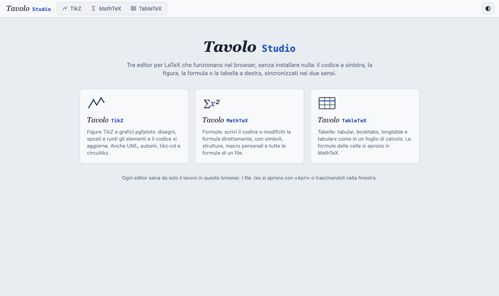

# Tavolo Studio

[](https://giozoc.github.io/tavolo-studio/)
[](#come-è-fatto)
[](#gli-editor)
[](#licenza)



---

Tavolo Studio riunisce in un'unica applicazione gli **editor visuali per LaTeX della famiglia Tavolo**. Funzionano interamente nel browser, senza installare nulla e senza backend. Tutti hanno la stessa interfaccia a due ante: il codice a sinistra, la figura, la formula o la tabella a destra, **sincronizzati nei due sensi**. Quando modifichi dalla vista, il codice cambia solo nel tratto toccato.

👉 <https://giozoc.github.io/tavolo-studio/>

## Gli editor

| Scheda | Cosa fa | Documentazione |
|---|---|---|
| **TikZ** | Figure TikZ e grafici pgfplots: disegni, sposti e ruoti gli elementi e il codice si aggiorna. Anche UML (tikz-uml), automi, diagrammi commutativi (tikz-cd), circuiti (circuitikz) e dati da CSV. | [apps/tikz](apps/tikz/README.md) |
| **MathTeX** | Formule: scrivi il codice o modifichi la formula direttamente (MathLive), con simboli, strutture, macro personali e tutte le formule di un file `.tex`. | [apps/mathtex](apps/mathtex/README.md) |
| **TableTeX** | Tabelle `tabular`, `tabularx`, `longtable` con `booktabs` e `siunitx`, modificate come in un foglio di calcolo; incolla da Excel e LibreOffice, tutte le tabelle di un file `.tex`. | [apps/tabletex](apps/tabletex/README.md) |

Si passa da un editor all'altro con le schede in alto. Ciascun editor ha un indirizzo diretto: `#tikz`, `#mathtex` o `#tabletex`. Lo Studio riapre l'ultimo editor usato.

**Insieme** gli editor fanno qualcosa in più:
- **un solo tema**, chiaro o scuro, per tutti, dal pulsante nella barra delle schede
- **le formule delle celle di TableTeX si aprono in MathTeX**. «Apri in Tavolo MathTeX» porta la formula nella scheda MathTeX, ogni modifica torna nella cella e «Fatto» riporta alla tabella. MathTeX ritrova poi la formula su cui stavi lavorando
- ogni editor **salva da solo** il proprio lavoro nel browser, con chiavi separate (`tz-`, `tl-`, `tt-`), così i tre non si disturbano

---

## Come è fatto

Ogni editor è un'applicazione a sé, in `apps/<nome>/`, fatta di script classici senza moduli né bundler. Si può ancora aprire da solo, per esempio da `apps/tikz/index.html`.

Lo Studio (`index.html`, `css/studio.css`, `js/studio.js`) è una cornice leggera:
- carica ciascun editor in un `iframe` della stessa origine, la prima volta che se ne apre la scheda. Così i nomi globali dei tre non si scontrano
- nasconde nei tre editor il nome e il pulsante del tema, che sono già nella barra dello Studio
- inoltra i messaggi del ponte delle formule. TableTeX chiede di aprire una formula (`studio:open`), MathTeX rimanda le modifiche (`tavolo:formula`) e chiude con `studio:done`. Lo Studio accetta solo messaggi della propria origine che vengono dai propri iframe

```text
tavolo-studio/
├── index.html              # cornice con le schede e la pagina iniziale
├── css/studio.css
├── js/studio.js            # schede, tema comune, ponte tra gli editor
├── apps/
│   ├── tikz/               # Tavolo TikZ
│   ├── mathtex/            # Tavolo MathTeX (con js/11-ponte.js)
│   └── tabletex/           # Tavolo TableTeX
├── tests/
│   ├── harness.py          # avvio dello Studio in Chromium headless
│   └── test_studio.py      # schede, tema, ponte delle formule
├── docs/studio.png
└── LICENSE
```

---

## Avvio

**Online**: <https://giozoc.github.io/tavolo-studio/>

**In locale**:

```bash
git clone https://github.com/giozoc/tavolo-studio.git
cd tavolo-studio
python3 -m http.server 8000
```

e apri il browser su `http://localhost:8000`. Serve un server statico qualsiasi. Aprendo `index.html` direttamente dal disco, il browser isola gli iframe e tema comune e ponte delle formule non funzionano. I singoli editor invece funzionano anche così.

**GitHub Pages**: si attiva Pages sul ramo `main`, cartella radice. L'indirizzo pubblico diventa `https://giozoc.github.io/tavolo-studio/`.

---

## Prove automatiche

Servono Python e Playwright (`pip install playwright pymupdf && playwright install chromium`):

```bash
cd tests && python test_studio.py           # cornice: schede, tema, ponte delle formule
cd apps/tikz/tests && python test_ui.py     # ogni editor ha le sue prove: vedi il suo README
cd apps/mathtex/tests && python test_ui.py
cd apps/tabletex/tests && python test_ui.py && python test_ponte.py
```

Le prove con `pdflatex` (`test_pdflatex.py` di ciascun editor) richiedono LaTeX installato.

---

## Storia

Tavolo TikZ e Tavolo MathTeX erano due repository separati. La loro storia è conservata qui, sotto `apps/tikz` e `apps/mathtex`: `git log -- apps/tikz` mostra tutti i commit di Tavolo TikZ. Tavolo TableTeX entra nello Studio dalla prima versione.

## Licenza

Questo progetto è distribuito sotto licenza **GNU GPL v3.0**.
