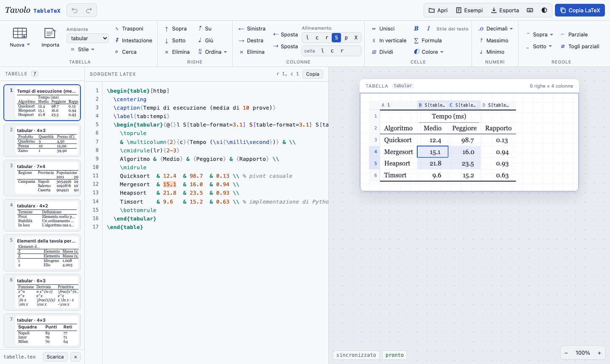

# Tavolo TableTeX

[](https://giozoc.github.io/tavolo-studio/#tabletex)
[](#stack-tecnologico)
[](#funzionalità)
[](#licenza)



> Fa parte di [**Tavolo Studio**](../../README.md), insieme agli altri editor della famiglia: si apre dalla scheda *TableTeX* di <https://giozoc.github.io/tavolo-studio/>, oppure da solo da `apps/tabletex/index.html`.

---

## Documentazione

Tavolo TableTeX è un **editor bidirezionale di tabelle LaTeX** (`tabular`, `tabular*`, `tabularx`, `longtable`, con le regole di `booktabs`; anche `NiceTabular` e, in modo essenziale, `tblr` di tabularray) che funziona interamente nel browser, senza installare nulla e senza backend. È il terzo della famiglia, dopo [Tavolo TikZ](../tikz/README.md) e [Tavolo MathTeX](../mathtex/README.md): stessa interfaccia a due ante, stessa attenzione al codice sorgente, applicate alle tabelle.

- **Contenuto del repository**:

  * Editor del sorgente LaTeX con evidenziazione, numeri di riga, suggerimenti dei comandi e segnalazione degli errori
  * Griglia modificabile tipo foglio di calcolo, con celle unite (`\multicolumn`, `\multirow`) disegnate come tali
  * Sincronizzazione bidirezionale che **riscrive solo la parte cambiata** del sorgente, e la verifica
  * Regole `booktabs`, linee classiche, allineamenti di colonna e colonne `S` di `siunitx` per i numeri
  * Incolla da Excel, LibreOffice e Google Fogli (celle unite comprese) e importazione di file CSV
  * Strumenti da foglio di calcolo: ordinare le righe, spostare le colonne, trasporre, decimali uniformi, massimo e minimo in grassetto, colori, cerca e sostituisci
  * Formule nelle celle con MathLive, e con **Tavolo MathTeX** in un'altra finestra
  * **Documenti interi**: lista delle tabelle di un file `.tex`, ciascuna modificabile, e salvataggio del file aggiornato
  * Esempi compilabili con pdfLaTeX e prove automatiche nel browser (scenari, prova a caso, pdfLaTeX su tutto)

---

## Panoramica del Progetto

Le tabelle sono probabilmente la parte di LaTeX che fa perdere più tempo. Gli strumenti che esistono, come i generatori online, funzionano quasi tutti in un solo senso: si disegna o si incolla, il programma genera il codice, e se poi il codice si modifica a mano non si torna più indietro.

Tavolo TableTeX tiene **il codice a sinistra e la griglia a destra, sincronizzati nei due sensi**:

- ogni modifica al codice si vede **subito** nella griglia, e il cursore nel codice seleziona la cella in cui si trova
- nella griglia si scrive come in un foglio di calcolo, si selezionano blocchi, si uniscono celle, si aggiungono righe, colonne e regole: il codice si aggiorna da solo
- la modifica dalla griglia **non rigenera la tabella**: commenti, a capo, rientri, allineamento delle `&` e grafia del sorgente restano dove sono, e cambia solo il tratto toccato
- il risultato è **LaTeX standard**, pronto da incollare in articoli, tesi e appunti; il documento esportato dichiara da solo i pacchetti che servono

Aprendo una tesi o un articolo, **tutte le tabelle compaiono in una lista laterale**, con didascalia e anteprima: si sceglie quella da modificare, le modifiche tornano nel punto giusto del file, e alla fine si scarica il documento intero.

> La griglia è una resa del codice, non un compilatore: mostra le regole, le celle unite, i numeri allineati sulla virgola e le formule (con MathJax), e lascia visibili i comandi che non conosce. Per la versione finale conviene comunque compilare con pdfLaTeX.

---

## Funzionalità

**Griglia** (tipo foglio di calcolo, sul foglio bianco della famiglia Tavolo)
- intestazioni di colonna con lettera e tipo (`l`, `c`, `S[table-format=3.1]`, `p{4cm}`, …) e numeri di riga
- celle unite disegnate come una cella sola: `\multicolumn`, `\multirow` (anche con `n` negativo) e i due insieme
- regole visibili con il loro spessore: `\toprule` e `\bottomrule` più spesse, `\midrule`, `\hline`, doppie `\hline\hline`, `\cmidrule` e `\cline` solo sulle colonne indicate (con i rientri di `\cmidrule(lr)`), `\addlinespace`; linee verticali dalla specifica (`|`, `||`)
- colonne `S` allineate sulla virgola decimale; testi non numerici in una colonna `S` segnalati se mancano le graffe
- contenuto reso in modo leggibile: formule con MathJax, `\textbf`, `\emph`, `\textsc`, `\makecell`, `\SI` e `\num`, `\cellcolor`, `\rowcolor` e le righe alterne di `\rowcolors` con i colori di `xcolor`, accenti e caratteri speciali; i comandi sconosciuti restano visibili come codice
- selezione con mouse e tastiera: clic, trascinamento, Maiusc+frecce, intere righe e colonne dalle intestazioni
- **modifica di una cella**: doppio clic, Invio o F2, oppure si comincia a scrivere; Invio conferma e scende, Tab conferma e va a destra (nell'ultima cella aggiunge una riga)
- nella cella `&`, `%` e `#` vengono protetti da soli, `_` e `^` fuori dalle formule diventano testo, un a capo diventa `\newline` nelle colonne a paragrafo e `\makecell` nelle altre, e in una colonna `S` il testo va tra graffe

**Barra multifunzione**
- *Tabella*: nuova tabella scegliendo righe e colonne (booktabs, griglia o senza regole; `tabular`, `tabularx` o `longtable`; dentro `table` o no), importazione, **ambiente** (cambia solo `\begin` e `\end`: verso `tabularx` una colonna di testo diventa `X`; anche `NiceTabular` e `tblr`), **stile** (booktabs ↔ griglia ↔ senza regole: si riscrivono solo le regole e i `|`), **trasponi** (righe ↔ colonne: ogni cella porta con sé il suo codice), **intestazione** ripetuta di una `longtable` (`\endhead` dopo le righe selezionate; di nuovo per toglierlo), **cerca e sostituisci** (Ctrl+H)
- *Righe*: inserisci sopra e sotto, elimina, sposta su e giù, **ordina** secondo la colonna della cella corrente (numeri come numeri, anche con la virgola; testo in ordine alfabetico italiano; celle vuote in fondo): senza una selezione di più righe l'intestazione resta ferma, le regole restano ai loro confini e il commento a fine riga segue la sua riga
- *Colonne*: inserisci a sinistra e a destra (il tipo si copia dalla vicina, i `|` si aggiungono se la tabella li usa, i `\cmidrule` si spostano), elimina, **sposta** a sinistra e a destra (Alt+frecce: si scambiano le lettere della specifica e le celle, i `|` restano dove sono), allineamento `l` `c` `r`, **`S` con `table-format` calcolato sui numeri della colonna**, `p{…}`, `X`
- *Celle*: unisci in orizzontale (`\multicolumn`), in verticale (`\multirow`), un blocco intero (`\multicolumn` su ogni riga e `\multirow` dentro, come vuole LaTeX), dividi, grassetto, corsivo, formula, **colore** (sfondo delle celle con `\cellcolor`, delle righe con `\rowcolor`, righe alterne con `\rowcolors` prima della tabella, testo con `\textcolor`), **allineamento di una cella sola** (`\multicolumn{1}{c}{…}`, che se ne va quando la cella torna come la colonna)
- *Numeri*: **decimali** uguali in tutta la colonna, riscrivendo i numeri (arrotondati sulle cifre, senza errori di virgola mobile, anche dentro `\textbf`, `\SI` o `$…$`) oppure lasciando fare a siunitx (`round-mode=places` nella colonna `S`); nelle colonne `S` il `table-format` segue; **massimo** e **minimo** di ogni colonna in grassetto
- *Regole*: sopra o sotto la selezione (`\toprule`, `\midrule`, `\bottomrule`, `\hline`, nessuna), regola parziale sulle colonne scelte (`\cmidrule(lr)` con booktabs, `\cline` nelle tabelle a griglia), togli le parziali

**Incolla e importa**
- **da Excel, LibreOffice e Google Fogli**: si legge la tabella HTML degli appunti, così le celle unite diventano `\multicolumn` e `\multirow`; il testo separato da tabulazioni è il ripiego
- si incolla dalla cella selezionata: se i dati escono dai bordi, la tabella cresce; un valore solo su più celle selezionate le riempie tutte
- righe LaTeX copiate da un altro sorgente (`a & b \\ c & d \\`) si incollano così come sono; una tabella LaTeX intera si aggiunge al sorgente
- **CSV** (pulsante *Importa*, *Apri* o trascinando il file): separatore riconosciuto da solo (virgola, punto e virgola, tabulazione), virgolette, virgola decimale; anteprima del codice, intestazione, colonne numeriche come `S`, stile, ambiente, didascalia. È lo stesso approccio dell'importazione dei dati di Tavolo TikZ
- i caratteri speciali dei dati (`& % $ # _ { } ~ ^ \`) vengono protetti; i numeri restano come sono
- copiando dalla griglia (Ctrl+C) si ottengono righe separate da tabulazioni, da incollare in un foglio di calcolo

**Formule nelle celle**
- **Ctrl+E**, il pulsante *Formula* o un doppio clic sulla formula aprono una piccola finestra con la formula modificabile (MathLive, lo stesso motore di Tavolo MathTeX) e il suo codice; in una cella senza formule ne aggiunge una
- **«Apri in Tavolo MathTeX»** porta la formula nell'editor completo, con barra multifunzione, gallerie e anteprima: ogni modifica fatta lì torna nella cella, finché la formula resta aperta (vedi [Integrazione con Tavolo MathTeX](#integrazione-con-tavolo-mathtex))

**Editor del codice**
- evidenziazione di comandi, ambienti, regole, `&`, `\\`, numeri, formule e commenti, con numeri di riga
- **suggerimenti dei comandi** delle tabelle mentre si scrive `\` + lettere (`\cmidrule`, `\multicolumn`, `\SI`, `\endhead`, …)
- la cella selezionata nella griglia è evidenziata nel codice; il tratto riscritto da una modifica si illumina per un istante
- errori segnalati senza bloccare: troppe `&` in una riga, `\cmidrule` fuori dalla tabella, graffe e ambienti non chiusi, testo non protetto in una colonna `S`; clic su un messaggio per andare al punto

**Documenti interi**
- aprendo un file `.tex` (pulsante *Apri* o trascinandolo), le tabelle compaiono in una **lista laterale** con didascalia e prime righe; ogni voce è l'ambiente `table` che contiene la tabella (con `\caption` e `\label`), oppure la tabella da sola
- un clic su una voce la porta nell'editor; **Alt+PagSu** e **Alt+PagGiù** passano alla precedente e alla successiva; ogni voce ha la sua cronologia
- ogni modifica torna nel documento, nel punto da cui viene la tabella, senza toccare il resto del file; le tabelle cambiate sono segnate e contate
- *Scarica* (o **Ctrl+S**) salva il file intero; chiudendo un documento con modifiche non scaricate, l'editor chiede se scaricarlo prima
- un sorgente con più tabelle senza un documento aperto si sfoglia con le frecce in alto sulla griglia

**Esportazione**
- copia del LaTeX con un pulsante e con **Ctrl+Maiusc+C**
- documento `.tex` con i pacchetti necessari, ricavati dalla tabella: `booktabs`, `multirow`, `siunitx`, `tabularx`, `longtable`, `array`, `makecell`, `xcolor` (con `table`), `hhline`, `arydshln`, `eurosym`, `nicematrix`, `tabularray` (con `\UseTblrLibrary{booktabs,siunitx}` quando servono); anche solo il preambolo
- dati della tabella come **CSV**, **Markdown** o testo per Excel
- **immagine** della tabella com'è disegnata nella griglia, senza intestazioni e selezione: **SVG** e **PNG** (a risoluzione tripla), per slide e anteprime
- annulla e ripeti con **una sola cronologia** per codice e griglia; 7 **esempi** pronti, gli stessi di `esempi/tabelle.tex`

**Interfaccia**
- tema chiaro e scuro, divisore tra le ante trascinabile, zoom della griglia
- su schermi stretti le ante si impilano: griglia in alto, codice sotto, lista delle tabelle in una striscia scorrevole
- il browser ricorda il sorgente, il documento aperto, il tema e lo zoom tra una visita e l'altra (in `localStorage`, solo su quel browser)

---

## Stack Tecnologico

- **Linguaggio**: JavaScript (ES2020), senza framework né passaggi di compilazione, come Tavolo TikZ e Tavolo MathTeX
- **Analisi delle tabelle**: scritta per questo progetto (`js/02-scan.js`), senza dipendenze
- **Formule nelle celle**: [MathJax](https://www.mathjax.org/) 3.2.2 per la resa, [MathLive](https://cortexjs.io/mathlive/) 0.111.1 per la modifica (licenza MIT, caricati da CDN; MathLive si usa solo quando si apre una formula)
- **Interfaccia**: HTML e CSS ripresi da Tavolo MathTeX, con temi chiaro e scuro
- **Pubblicazione**: sito statico, adatto a GitHub Pages

---

## Architettura

Tre livelli distinti, sempre separati:

1. **Sorgente** – il testo dell'utente, unica fonte di verità. Non viene mai riscritto per intero se non è indispensabile
2. **Modello** – la scansione del sorgente (`js/02-scan.js`): ambiente, intestazione, specifica delle colonne (con `>{…}`, `<{…}`, `@{…}`, `|` e i gruppi `*{n}{…}`), righe, celle, regole e commenti, **ciascuno con la sua posizione nel testo**. Non si conserva: si ricava di nuovo dopo ogni cambio
3. **Griglia** – la vista modificabile (`js/07-grid.js`), ricavata dal modello, con la disposizione delle celle unite

### Sincronizzazione

È a senso unico per evento, così non nascono cicli:

- **codice → griglia**: a ogni battitura il sorgente si rilegge e la griglia si ridisegna, tenendo la selezione
- **griglia → codice** (`js/03-model.js` e `js/04-ops.js`): ogni comando della griglia ha due versioni
  1. una **astratta**, sulla forma della tabella (righe di celle con contenuto ed estensione, colonne, regole a ogni confine tra righe): dice *che cosa* deve risultare
  2. una **sul testo**, che produce poche sostituzioni puntuali: il contenuto di una cella, una lettera della specifica, una riga intera, un comando di regola, il numero di un `\multicolumn`
  3. il sorgente modificato **si rilegge e si verifica**: la sua forma astratta deve coincidere esattamente con quella attesa. Se non coincide si riscrivono, in ordine, solo le righe diverse e poi l'intero corpo; se nemmeno così torna, la modifica non si applica e lo si dice

Qualche esempio di ciò che la riscrittura sul testo fa per non toccare il resto:

- una cella si cambia sostituendo solo il suo contenuto: spazi, allineamento delle `&` e commento a fine riga restano; dentro `\multicolumn{2}{c}{…}` cambia solo l'ultimo argomento
- una riga nuova copia il rientro della vicina e va **dopo** le regole che la precedono (sotto l'intestazione e il suo `\midrule` finisce tra i dati); nelle tabelle con `\hline` ovunque riceve anche la sua `\hline`
- una colonna nuova aggiunge una `&` per riga nel punto giusto, allarga i `\multicolumn` che la attraversano, sposta gli intervalli di `\cmidrule` e `\cline`, e mette `|` nella specifica solo se la tabella li usa; un gruppo `*{3}{c}` viene scritto per esteso solo se la modifica lo tocca
- eliminando una riga si portano via i suoi commenti; le sue regole restano, a meno che quella sotto non abbia già le stesse; un `\multirow` che la copriva si accorcia
- lo stile booktabs ↔ griglia cambia le regole e i `|`, non le celle
- ordinare è una permutazione delle righe: ogni riga prende il testo di un'altra, e le regole restano dove sono; spostare una colonna scambia due tratti della specifica e due celle per riga
- unendo e dividendo celle, il testo passa così com'è nel sorgente: i commenti scritti dentro le celle, o tra una cella e l'altra, finiscono nella cella nuova su una riga loro

### Documenti

`js/11-document.js` divide il file in testo e tabelle: `gaps[k]` è il testo prima della voce `k`, `items[k]` la voce. La voce scelta va nell'editor come un sorgente qualsiasi; ogni cambio torna in `items[k]`, e il file si ricompone unendo le due liste. Il resto del documento non passa mai dall'editor, quindi non può essere alterato. È lo stesso schema delle formule di Tavolo MathTeX.

---

## Integrazione con Tavolo MathTeX

Il pulsante **«Apri in Tavolo MathTeX»** apre l'editor delle formule con la formula della cella: dentro Tavolo Studio nella scheda *MathTeX*, da solo in un'altra finestra. Il protocollo è minimo e non richiede un server:

1. Tavolo TableTeX apre `../mathtex/index.html#tabletex=…`, con la formula, un identificativo e la propria origine codificati in base64 nel frammento (che non arriva mai a un server); nello Studio chiede invece alla cornice di aprire quell'indirizzo nella scheda di MathTeX
2. Tavolo MathTeX, con il file `apps/mathtex/js/11-ponte.js`, carica la formula, mostra una barra «Formula della cella B4 di Tavolo TableTeX» e a ogni modifica rimanda la formula con `postMessage`, **solo verso l'origine che l'ha aperta**; delimitatori esterni e commenti vengono tolti, perché in una cella romperebbero la riga
3. Tavolo TableTeX accetta i messaggi **solo dall'origine di Tavolo MathTeX** e solo per gli identificativi che ha aperto, rilegge la cella (il sorgente può essere cambiato nel frattempo) e sostituisce solo quella formula, con la stessa riscrittura minima
4. nello Studio «Fatto» riporta alla scheda di TableTeX, e MathTeX torna alla formula su cui si stava lavorando; in una finestra a parte la chiude

Lo stesso file è pronto anche per [Tavolo TikZ](../tikz/README.md), con il frammento `#tikz=…` (la barra direbbe allora «Formula del nodo alla riga 12 in Tavolo TikZ»); in Tavolo TikZ il pulsante per aprire le formule dei nodi non c'è ancora.

Senza il frammento `#tabletex` o `#tikz` il file non fa nulla, e il lavoro già salvato in Tavolo MathTeX (formula e documento aperto) resta com'era. L'indirizzo di Tavolo MathTeX si può cambiare, per esempio per una copia in locale, con `localStorage.setItem('tt-mathtex-url', 'http://localhost:8001/')`; senza, si usa la copia accanto, in `apps/mathtex`.

---

## Struttura del Repository

```text
apps/tabletex/
├── index.html              # pagina principale
├── css/
│   └── style.css           # stile e temi, ripresi da Tavolo MathTeX, più la griglia
├── js/
│   ├── 01-core.js          # utilità, modali, tema, divisore, resa MathJax (da Tavolo MathTeX)
│   ├── 02-scan.js          # ambienti, specifica delle colonne, righe, celle, regole, controlli
│   ├── 03-model.js         # forma astratta, operazioni attese, disposizione delle celle unite, generazione
│   ├── 04-ops.js           # riscrittura minima del sorgente, verifica e ripieghi
│   ├── 05-editor.js        # editor del codice, cronologia, suggerimenti, messaggi
│   ├── 06-render.js        # resa del contenuto delle celle in HTML
│   ├── 07-grid.js          # griglia: disegno, selezione, modifica delle celle, tastiera, appunti
│   ├── 08-ribbon.js        # barra multifunzione e finestre a comparsa
│   ├── 09-paste.js         # incolla da fogli di calcolo, CSV, righe LaTeX
│   ├── 10-formula.js       # formule nelle celle: MathLive e ponte con Tavolo MathTeX
│   ├── 11-document.js      # tabelle del file aperto
│   ├── 12-panel.js         # esempi, esportazione, pacchetti, apertura dei file, scorciatoie, avvio
│   └── 13-tools.js         # ordinamento, decimali, colori, cerca e sostituisci, immagine SVG e PNG
├── esempi/
│   └── tabelle.tex         # gli esempi dell'editor, compilabili con pdfLaTeX
├── tests/
│   ├── harness.py          # avvio dell'app in Chromium headless
│   ├── test_ui.py          # scenari con mouse e tastiera
│   ├── test_fuzz.py        # operazioni casuali sulla griglia
│   ├── test_pdflatex.py    # compilazione con pdfLaTeX
│   ├── test_ponte.py       # ponte con Tavolo MathTeX
│   └── readme_shot.py      # immagine del README
├── docs/
│   └── anteprima.png       # immagine del README
└── LICENSE
```

I file in `js/` sono script classici caricati in ordine da `index.html`, senza moduli né bundler: ciascuno usa ciò che definiscono i precedenti.

---

## Avvio

**Online**: [giozoc.github.io/tavolo-studio](<https://giozoc.github.io/tavolo-studio/#tabletex>) (scheda *TableTeX*)

**In locale**:

1. Clona il repository di Tavolo Studio ed entra in `apps/tabletex`.
2. Avvia un server statico e apri il browser su `http://localhost:8000`:

```bash
   python3 -m http.server 8000
```

   Non servono altri passaggi: i file si caricano così come sono (MathJax e MathLive arrivano dal CDN jsDelivr). Funziona anche aprendo direttamente `index.html`.

3. Viene pubblicato su GitHub Pages insieme agli altri editor di Tavolo Studio (vedi il [README principale](../../README.md)).

4. Per confrontare con LaTeX, compila gli esempi:

```bash
   cd esempi
   pdflatex tabelle.tex
```

---

## Prove automatiche

Le prove usano Playwright con Chromium e si eseguono dalla cartella `tests`:

```bash
pip install playwright && playwright install chromium
cd tests
python test_ui.py          # facoltativo: percorso dello screenshot finale (predefinito ui.png)
python test_fuzz.py        # facoltativi: passi per tabella e numero di semi (predefiniti 60 e 3)
python test_pdflatex.py    # richiede pdflatex nel PATH; usa anche le tabelle della prova a caso
python test_ponte.py       # ponte con Tavolo MathTeX di apps/mathtex (o MATHTEX_DIR=…)
python readme_shot.py ../docs/anteprima.png
```

| Prova | Cosa controlla |
|---|---|
| `test_ui.py` | scenari reali con mouse e tastiera: cella modificata scrivendo (cambia solo il numero, il commento resta), codice che aggiorna la griglia e cursore che seleziona la cella, righe e colonne inserite ed eliminate (il sorgente torna identico), `\multicolumn` con Ctrl+M e divisione, `\multirow`, colonna `S` con `table-format` e graffe, regole sopra e sotto, `\cmidrule` sulla selezione, booktabs ↔ griglia, `tabularx`, `& % _` protetti, annulla e ripeti, incolla da Excel con celle unite, incolla oltre i bordi, Tab nell'ultima cella, copia e cancella, formule con Ctrl+E e MathLive, `longtable` con didascalia, documento intero (lista, modifica riscritta nel file, Alt+PagSu, Ctrl+S), importazione CSV con virgola decimale, nuova tabella, errori, righe spostate, grassetto, colonne spostate con Alt+frecce, ordinamento per numeri e per testo (commenti che seguono la riga, rifiuto con `\multirow`), trasposizione e ritorno, allineamento di una cella, colori di celle, righe e righe alterne, decimali riscritti e affidati a siunitx, massimo in grassetto, cerca e sostituisci con Ctrl+H, `\endhead`, commenti conservati unendo e dividendo, `tblr` con `colspec={…}` e `NiceTabular`, immagine SVG e PNG, tema scuro e schermo stretto |
| `test_fuzz.py` | migliaia di operazioni casuali della griglia (celle, righe, colonne, allineamenti, regole, unioni, divisioni, incolla, stili, ambienti, colonne spostate, ordinamenti, trasposizioni, allineamenti di cella, colori, decimali, massimi, `\endhead`) su tabelle booktabs, a griglia, con `siunitx`, celle unite, `longtable`, `tabularx` su una riga sola, `tblr`, `NiceTabular`, commenti ovunque e specifiche con `*{n}{…}`: il sorgente riletto deve dare la griglia attesa, restare identico fuori dal tratto cambiato, conservare i commenti e non diventare non valido |
| `test_pdflatex.py` | compila con pdfLaTeX tutto ciò che l'editor produce: esempi, ogni comando della barra (strumenti compresi) su ogni esempio con selezioni diverse, nuove tabelle in ogni stile e ambiente, importazioni CSV, incolla con celle unite, tabelle della prova a caso, ciascuna con i pacchetti dichiarati dall'esportazione |
| `test_ponte.py` | formula aperta in Tavolo MathTeX, modifiche che tornano nella cella (e solo lì), delimitatori e commenti tolti, messaggi da altre origini ignorati |

Ultimo risultato: 94/94 scenari superati; su 4339 operazioni casuali (150 passi, 6 semi) il 100% riscrive solo il tratto cambiato (in media il 3,8% del sorgente: trasporre e ordinare toccano tratti più lunghi), con zero modifiche rifiutate, zero caratteri alterati fuori dal tratto, zero commenti persi (anche unendo e dividendo celle) e zero sorgenti resi non validi. pdfLaTeX: delle 847 tabelle raccolte sono state compilate le 409 che non chiedono `colortbl`, `multirow`, `makecell`, `tabularray` o `nicematrix`, assenti nella distribuzione MiKTeX della prova: 409 su 409; le altre (colori, celle unite in verticale, `tblr`, `NiceTabular`) vanno verificate con una distribuzione completa. La prova del ponte con Tavolo MathTeX non è stata ripetuta.

Senza rete, la variabile `LOCAL_LIBS` può puntare a una cartella `node_modules` con `mathjax` e `mathlive`.

---

## Scorciatoie

Su Mac, Ctrl corrisponde a Cmd.

| Tasto | Azione |
|---|---|
| Ctrl+Z / Ctrl+Y (o Ctrl+Maiusc+Z) | Annulla / Ripeti (codice e griglia condividono la cronologia; con un documento aperto, una per tabella) |
| Ctrl+Maiusc+C | Copia il codice LaTeX |
| Ctrl+S | Scarica la tabella come documento `.tex`; con un file aperto, il file intero con le tabelle aggiornate |
| Ctrl+H | Cerca e sostituisci nelle celle (Invio: cella successiva; Ctrl+Invio in «Sostituisci con»: tutte) |
| Alt+PagSu / Alt+PagGiù | Tabella precedente / successiva del file aperto |
| F1 · Esc | Elenco delle scorciatoie · chiude finestre e selezioni |

**Nella griglia**

| Tasto | Azione |
|---|---|
| Frecce · Maiusc+frecce | Cella corrente · allarga la selezione (anche trascinando) |
| Invio · F2 · doppio clic | Modifica la cella; scrivere un carattere la sostituisce |
| Invio · Tab · Esc | (durante la modifica) conferma e scende · conferma e va a destra · annulla |
| Tab nell'ultima cella | Aggiunge una riga |
| Canc · Backspace | Svuota le celle selezionate |
| Ctrl+C · Ctrl+X · Ctrl+V | Copia, taglia, incolla (anche da Excel, LibreOffice, Google Fogli e righe LaTeX) |
| Ctrl+Invio · Ctrl+Maiusc+Su | Riga sotto · riga sopra |
| Ctrl+− · Alt+Su · Alt+Giù | Elimina le righe · sposta la riga |
| Alt+Sinistra · Alt+Destra | Sposta la colonna (o il blocco di colonne selezionate) |
| Ctrl+B · Ctrl+I | Grassetto · corsivo (di nuovo per toglierli) |
| Ctrl+M | Unisci le celle |
| Ctrl+E · doppio clic su una formula | Modifica la formula della cella |
| Ctrl+A · Ctrl+Home · Ctrl+Fine | Tutta la tabella · prima cella · ultima cella |

**Nel codice**

| Tasto | Azione |
|---|---|
| `\` + lettere | Suggerimenti dei comandi (frecce per scegliere, Tab o Invio per completare) |
| Tab · Invio | Due spazi · a capo con lo stesso rientro |
| Clic nel codice | Seleziona la cella corrispondente nella griglia |
| Clic su un messaggio | Porta all'errore nel sorgente |

---

## Limiti Noti

- Gli ambienti riconosciuti sono `tabular`, `tabular*`, `tabularx`, `tabulary`, `longtable`, `NiceTabular` (anche `*` e `X`) e `tblr` (anche `longtblr` e `talltblr`); `array` in modo matematico resta testo del sorgente.
- Il supporto di `tblr` è essenziale: celle, righe, colonne, regole e colonne `Q[…]`, `X[…]`, `S[…]` si modificano, anche con la specifica dentro `colspec={…}`, ma le celle unite con `\SetCell[c=2]{…}` si disegnano come celle singole e non si creano dalla barra (in tabularray non esistono `\multicolumn` e `\multirow`). Con `colspec={…}` l'ambiente si cambia nel codice. In `NiceTabular`, `\Block` mostra il suo contenuto ma non unisce le celle nella griglia.
- La griglia non è un compilatore: larghezze, spaziature e colori sono approssimati, e i comandi personali appaiono come codice. Le tabelle annidate in una cella si mostrano semplificate.
- Una `longtable` con didascalia o `\endhead`/`\endfoot` non si converte in `tabular` dalla barra (in `tabular` quei comandi non esistono); le colonne `X` non sono disponibili in `longtable`.
- Le celle unite che si sovrappongono a contenuti non vuoti (un `\multirow` che copre celle scritte) vengono disegnate senza unione, come le tratterebbe LaTeX.
- Trasponendo, i commenti fuori dalle celle (a fine riga o su una riga loro) si perdono, e l'editor dice quanti; la trasposizione e l'ordinamento rifiutano le tabelle con celle unite in verticale, e la trasposizione anche quelle con `\cmidrule`, `\rowcolor` o didascalia.
- L'immagine SVG e PNG è la resa della griglia, non di LaTeX: usa i caratteri disponibili nel sistema. Alcuni browser (Safari) non permettono il PNG: resta l'SVG.
- `\rowcolors` vale fino alla fine del gruppo: fuori da un ambiente `table` colora anche le tabelle che seguono.
- Sorgente e documento sono conservati solo nel browser in uso: per non perdere il lavoro conviene scaricare il file.

---

## Ringraziamenti

Interfaccia e impostazione tecnica riprese da [Tavolo TikZ](../tikz/README.md) e [Tavolo MathTeX](../mathtex/README.md). Formule con [MathJax](https://www.mathjax.org/) e [MathLive](https://github.com/arnog/mathlive) di Arno Gourdol (MIT).

---

## Licenza

Questo progetto è distribuito sotto licenza **GNU GPL v3.0**, come Tavolo TikZ e Tavolo MathTeX.
