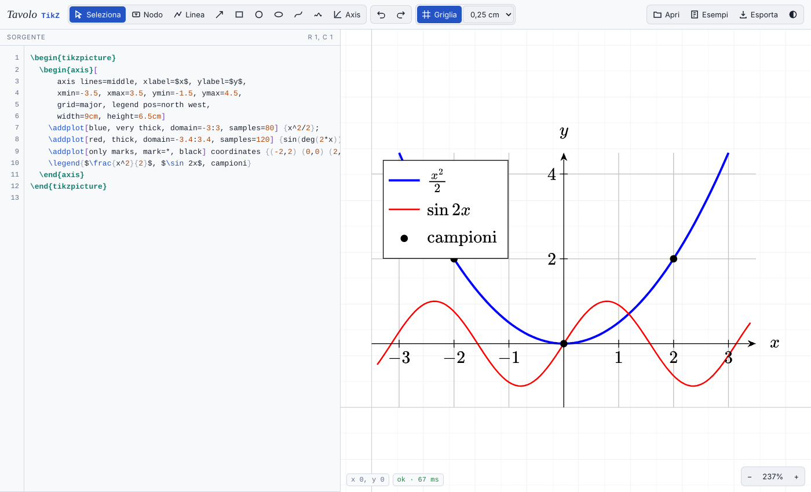

# Tavolo TikZ

[](https://giozoc.github.io/tavolo-studio/#tikz)
[](#stack-tecnologico)
[](#funzionalità)
[](#licenza)



> Fa parte di [**Tavolo Studio**](../../README.md), insieme agli altri editor della famiglia: si apre dalla scheda *TikZ* di <https://giozoc.github.io/tavolo-studio/>, oppure da solo da `apps/tikz/index.html`.

---

## Documentazione

Tavolo TikZ è un **editor visuale per figure TikZ, grafici pgfplots, diagrammi commutativi e circuiti** che funziona interamente nel browser, senza installare nulla e senza compilare con LaTeX a ogni modifica.

- **Demo online**
  L'editor pubblicato con GitHub Pages:
  👉 <https://giozoc.github.io/tavolo-studio/#tikz>

- **Contenuto del repository**:

  * Interprete TikZ scritto da zero in JavaScript (percorsi, nodi, `\foreach`, scope, stili)
  * Motore pgfplots per gli ambienti `axis` e i comandi `\addplot`
  * Supporto a tikz-uml, alla libreria `automata`, a tikz-cd e a circuitikz, ciascuno con il proprio pannello di inserimento
  * Interfaccia con editor del codice, area di disegno e pannello proprietà
  * 18 esempi pronti, caricabili dal pulsante **Esempi**
  * Esempi `.tex` compilabili con pdfLaTeX per il confronto con l'anteprima
  * Test automatici con Playwright, tra cui il confronto tra l'anteprima e il PDF compilato

---

## Panoramica del Progetto

Scrivere figure in TikZ significa di solito modificare un numero, ricompilare, guardare il PDF e ripetere. Tavolo TikZ accorcia questo ciclo: il codice a sinistra e il disegno a destra restano **sincronizzati nei due sensi**.

- ogni modifica al codice si vede **subito** nel disegno
- spostando, ruotando o ridimensionando un elemento sul disegno, l'editor **riscrive solo i numeri interessati**, lasciando intatta la formattazione del codice (a capo, spazi, commenti)
- gli **ambienti `axis` di pgfplots funzionano davvero**: limiti automatici, griglie, legende, barre, scale logaritmiche, aree tra curve
- i **testi dei nodi** si modificano dal pannello (corpo, posizione, colore) e si spostano trascinandoli, anche quando stanno dentro un `\draw`
- **diagrammi UML, automi, diagrammi commutativi e circuiti** si costruiscono anche con un clic, dai pannelli dedicati
- il risultato si esporta come **codice TikZ**, **documento `standalone`** con i pacchetti e le librerie necessari, **SVG** o **PNG**
- il codice, i file di dati e la larghezza dei pannelli restano **salvati nel browser** e si ritrovano alla riapertura

> L'anteprima è fedele ma non identica a pdfLaTeX: per la versione finale conviene sempre compilare il codice esportato.

---

## Funzionalità

**pgfplots**
- `axis`, `semilogxaxis`, `semilogyaxis`, `loglogaxis`
- `\addplot` con funzioni `{x^2}`, parametriche, `coordinates`, `table {…}`, `fill between`
- **dati da file**: `\addplot table[x=…, y=…, col sep=comma] {dati.csv}`, `\pgfplotstableread{dati.csv}\tabella` con `table {\tabella}`, `plot file {…}` di TikZ; il pulsante **Dati** (o il trascinamento del `.tex` insieme ai suoi file) carica `.csv`, `.dat`, `.tsv` accanto al sorgente, e restano nel browser fino a quando li rimuovi
- barre `ybar`/`xbar`, `stacked`, `nodes near coords`, `symbolic x coords`, `xtick=data`
- `axis lines`, `grid`, tick personalizzati, `axis equal`, legende, coordinate `axis cs:`

**TikZ**
- nodi con oltre 25 forme, ancore, `label`, `pin`
- `\foreach` (con `/`, `count`, `evaluate`, `...`), `calc`, `positioning` (`right=of`)
- `to[bend left]`, `loop`, `|-` e `-|`, curve di Bézier, `arc`, `grid`, `plot`
- scope e trasformazioni, alberi (`child`), `matrix of nodes`
- sfumature, pattern, `\clip`, stili `/.style`, `\definecolor`, `\pgfmathsetmacro`

**tikz-uml** (`\usepackage{tikz-uml}`)
- classi: `\umlclass`, `\umlabstract`, `\umlinterface`, `\umltypedef`, `\umlenum`, `\umlsimpleclass`, con `template`, `\umlstatic`, `\umlvirt`
- relazioni: `\umlassoc`, `\umluniassoc`, `\umlaggreg`, `\umlcompo`, `\umlinherit`, `\umlimpl`, `\umldep`, `\umlimport`, … con `geometry` (`--`, `-|`, `|-`, `-|-`, `|-|`), varianti `\umlHV…`/`\umlVH…`, `arg`/`mult`/`pos`, `stereo`, `anchor1`/`anchor2`, relazioni ricorsive
- `\umlnote`, ambienti `umlpackage`, `umlsystem` e `umlstate` che si adattano al contenuto
- casi d'uso (`\umlactor`, `\umlusecase`, `\umlinclude`, `\umlextend`) e stati (`\umlbasicstate`, `\umlstateinitial`, `\umlstatefinal`, `\umlstatedecision`, `\umltrans`)
- diagrammi di sequenza: `umlseqdiag`, `\umlobject`, `\umlactor`, `\umldatabase`, `\umlentity`, `\umlboundary`, `\umlcontrol`, `\umlmulti`, chiamate `umlcall` e `umlcallself` (sincrone e asincrone, annidate), `\umlcreatecall`, frammenti `umlfragment` con `\umlfpart`
- diagrammi di componenti: `\umlbasiccomponent`, ambiente `umlcomponent`, `\umlprovidedinterface`, `\umlrequiredinterface`, `\umlport`, `\umlassemblyconnector`, `\umldelegateconnector`
- pulsante **UML** (tasto `U`): apre accanto al sorgente un pannello con tutti gli elementi; si inseriscono con un clic sul disegno (anche dentro un pacchetto, un sistema o un componente) e le relazioni con un clic sui due elementi da collegare
- `\tikzumlset` per i colori predefiniti; le classi si spostano trascinandole (si riscrivono `x` e `y`) e il pannello modifica testi, colori e geometria

**Automi** (`\usetikzlibrary{automata}`)
- stati `state` (anche `state with output`), `initial` e `accepting` con le varianti `initial above`/`below`/`left`/`right`, `initial text`, `initial where`, `initial distance`, `accepting by double`, `accepting by arrow`, `accepting text`
- stili `every state`, `every initial by arrow`, `every accepting by arrow`; posizionamento con `on grid` e `node distance`
- transizioni con `edge`, `bend left`/`bend right`, cappi `loop above`/`below`/`left`/`right` verso `()`, etichette con `auto` e `swap`
- pulsante **Automi** (tasto `M`): apre un pannello per inserire stati con un clic sul disegno, transizioni e transizioni curve con un clic sui due stati, cappi con un clic sullo stato; rende uno stato iniziale o accettante con un clic, e lo stesso si fa dalle caselle del pannello proprietà

**tikz-cd** (`\usepackage{tikz-cd}`)
- ambiente `tikzcd` con `row sep`, `column sep`, `sep` (anche `small`, `large`, `huge`…), `cells`, `arrows`, `labels`, `\tikzcdset`, `ampersand replacement`, opzioni di cella `|[…]|`
- `\arrow`/`\ar` con direzioni (`r`, `dr`, `uul`…), `from`/`to`, e le forme brevi `\rar`, `\dar`…; sintassi vecchia `\arrow{r}{f}`
- etichette `"f"`, `"f"'`, `description`, `near start`, `marking`; stili `Rightarrow`, `hook`, `two heads`, `tail`, `mapsto`, `equal`, `dashed`, `squiggly`, `phantom` (angoli di pullback), `crossing over`, `bend left`, `shift left`/`right`, `start anchor`/`end anchor`, cappi
- pulsante **tikz-cd** (tasto `D`): oggetti con un clic in una cella (righe e colonne si aggiungono da sole, anche sopra e a sinistra), frecce con un clic sui due oggetti; il pannello proprietà cambia etichetta, lato, tipo, tratto, curvatura e direzione

**circuitikz** (`\usepackage{circuitikz}`)
- componenti sui percorsi `to[…]`: `R`, `C`, `L`, `V`, `I`, `sV`, `battery1`, `D`, `leD`, `zD`, `lamp`, `fuse`, `switch`, `ammeter`, `voltmeter`, `short`, `open`, con stile americano o europeo (`\usepackage[european]{circuitikz}`, `\ctikzset`)
- etichette `R=$R_1$`, `l`, `l_`, `a`, tensioni `v`, `v_`, `v<`, correnti `i`, `i_`, `i<`, poli `*-*`, `o-o`, `-*`, `invert`, `mirror`, `bipoles/length`
- nodi `ground`, `rground`, `sground`, `vcc`, `vee`, `circ`, `ocirc`, `op amp` (ancore `-`, `+`, `out`), `npn`/`pnp` (`B`, `C`, `E`), `nmos`/`pmos` (`G`, `D`, `S`); anche l'ambiente `circuitikz`
- pulsante **Circuiti** (tasto `K`): componenti con un clic sui due capi, nodi con un clic sul disegno; il pannello proprietà cambia tipo ed etichetta di ogni componente del percorso
- collegamenti a più punti (`--` o ad angolo `-|`) che si chiudono su un capo, con doppio clic o con **Invio**; i punti si agganciano ai capi dei componenti e alle ancore dei nodi
- spostando un componente, i collegamenti e i componenti che vi arrivano lo seguono

**Modifica visuale**
- strumenti: nodo, linea (doppio clic o **Invio** per finire), freccia (si aggancia ai nodi), rettangolo, cerchio, ellisse, Bézier, mano libera, grafico `axis`
- aggancio alla griglia con passo da 1 cm a 1 mm; **Alt** per spostare liberamente
- campi numerici per ogni punto e frecce da tastiera (**Maiusc**: passo ×4, **Ctrl**: passo 0,01)
- rotazione con maniglia o valore in gradi (`rotate`, `rotate around`)
- **doppio clic** su un nodo per modificarne il testo direttamente sul disegno
- duplica (**Ctrl + D**), elimina, annulla e ripeti
- zoom con la rotella (o **Ctrl** + rotella, o con due dita sugli schermi tattili), spostamento della vista con **Spazio** + trascina, adattamento alla figura
- livelli `pgfonlayer` per gli elementi di sfondo

**Editor del codice**
- evidenziazione della sintassi, numeri di riga, posizione del cursore
- completamento automatico di comandi (`\draw`, `\addplot`, `\begin{…}` con il relativo `\end`, …) e di opzioni dentro `[…]`
- **Alt + ↑/↓** su un numero lo aumenta o lo diminuisce (passo 0,1; con **Maiusc** passo 1); **Alt + trascina** su un numero lo fa scorrere col mouse
- rientro automatico con **Invio** e **Tab**
- avvisi sotto il codice per i comandi non supportati o con errori, senza interrompere il resto della figura
- divisore trascinabile tra codice e disegno

**File ed esportazione**
- apertura di file `.tex`, `.tikz`, `.pgf` (pulsante **Apri** o trascinamento); se il file contiene più figure, l'elenco **Figure** a sinistra le mostra in miniatura: un clic porta la figura nel disegno e il codice al suo inizio; **Alt+PagSu** e **Alt+PagGiù** passano alla precedente e alla successiva
- **Esporta**: copia del solo codice TikZ, copia di un documento `standalone` completo (con `tikz-uml`, `tikz-cd`, `circuitikz`, `amssymb` e le librerie usate), download dell'**SVG** e anteprima **PNG** ad alta risoluzione da salvare con il clic destro; se la figura legge file di dati, l'esportazione lo ricorda
- tema chiaro e scuro

**Esempi integrati**

Funzioni, barre, area tra curve e scala logaritmica (pgfplots), diagramma a blocchi, geometria, grafo, automa, albero, matrice, onde con `\foreach`, classi, stati, sequenza e componenti (tikz-uml), diagramma commutativo (tikz-cd), circuito RLC (circuitikz), dati da CSV. Un esempio sostituisce il codice attuale, ma si torna indietro con **Ctrl + Z**.

---

## Stack Tecnologico

- **Linguaggio**: JavaScript (ES2020), senza framework né dipendenze da installare
- **Rendering**: SVG generato direttamente dal codice TikZ
- **Testo matematico**: [MathJax 3](https://www.mathjax.org/) (caricato da CDN)
- **Interfaccia**: HTML e CSS, con temi chiaro e scuro; caratteri da Google Fonts
- **Memoria locale**: `localStorage` per il codice, i file di dati e la disposizione
- **Test**: Python con [Playwright](https://playwright.dev/python/) e [PyMuPDF](https://pymupdf.readthedocs.io/)
- **Pubblicazione**: GitHub Pages (sito statico)

---

## Architettura

L'editor elabora il codice in una **pipeline a fasi**, rieseguita a ogni modifica:

1. **Scansione** – individua le figure `tikzpicture` nel sorgente e il preambolo (`\definecolor`, `\tikzset`, …)
2. **Interpretazione** – esegue i comandi TikZ, espande `\foreach`, macro e stili, valuta le espressioni pgfmath
3. **Geometria** – calcola percorsi, nodi, ancore e frecce in coordinate di pagina
4. **pgfplots** – per ogni `axis` raccoglie i dati (anche dai file caricati), calcola limiti e tick, poi disegna grafici e legenda
5. **Pacchetti** – tikz-uml, `automata`, tikz-cd e circuitikz traducono i propri comandi e ambienti in nodi e percorsi TikZ, che seguono poi la stessa strada
6. **Rendering** – produce l'SVG e registra, per ogni elemento, la posizione dei numeri nel sorgente
7. **Modifica inversa** – quando trascini un elemento, converte la nuova posizione in coordinate e riscrive solo quei numeri

I pannelli (UML, automi, tikz-cd, circuiti) non hanno un modello proprio: inseriscono o modificano righe di codice, e il disegno si aggiorna rieseguendo la pipeline.

---

## Struttura del Repository

```text
apps/tikz/
├── index.html                  # pagina principale
├── css/
│   └── style.css               # stile e temi chiaro/scuro
├── js/
│   ├── 01-core.js              # unità, colori, espressioni pgfmath, geometria
│   ├── 02-style.js             # interpretazione delle opzioni TikZ
│   ├── 03-text.js              # testo LaTeX con MathJax
│   ├── 04-nodes.js             # forme dei nodi, ancore, frecce
│   ├── 05-interpreter.js       # comandi, \foreach, scope
│   ├── 06-path.js              # percorsi e coordinate
│   ├── 07-path-nodes.js        # nodi nei percorsi, alberi, matrici
│   ├── 08-pgfplots.js          # ambienti axis e \addplot
│   ├── 09-render.js            # rendering di una figura
│   ├── 10-uml.js               # comandi tikz-uml (classi, pacchetti, casi d'uso, stati)
│   ├── 11-automata.js          # libreria automata (stati iniziali e accettanti)
│   ├── 12-tikzcd.js            # diagrammi commutativi (ambiente tikzcd)
│   ├── 13-circuitikz.js        # componenti e nodi di circuitikz
│   ├── 14-ui.js                # editor del codice e vista
│   ├── 15-tools.js             # strumenti, trascinamento, rotazione
│   ├── 16-panel.js             # pannello proprietà, esportazione, esempi, file di dati
│   ├── 17-palette.js           # pannello degli elementi UML
│   ├── 18-automata-palette.js  # pannello degli automi
│   ├── 19-cd-palette.js        # pannello di tikz-cd
│   └── 20-circuit-palette.js   # pannello dei circuiti
├── esempi/                     # figure .tex compilabili con pdfLaTeX (e misure.csv)
├── tests/
│   ├── harness.py              # apre l'editor in Chromium headless, senza server
│   ├── test_ui.py              # scenari d'uso con mouse e tastiera
│   ├── test_pdflatex.py        # confronto tra anteprima e PDF compilato
│   ├── baseline.json           # punteggi di riferimento per esempio
│   └── requirements.txt        # playwright, pymupdf
├── docs/
│   └── anteprima.png           # immagine del README
└── LICENSE
```

---

## Avvio

**Online**: apri <https://giozoc.github.io/tavolo-studio/#tikz> (scheda *TikZ* di Tavolo Studio).

**In locale**:

1. Clona il repository di Tavolo Studio ed entra nella cartella dell'editor:

```bash
   git clone https://github.com/giozoc/tavolo-studio.git
   cd tavolo-studio/apps/tikz
```

2. Avvia un server statico e apri il browser su `http://localhost:8000`:

```bash
   python3 -m http.server 8000
```

   Non servono altri passaggi: i file si caricano così come sono.

3. Per confrontare l'anteprima con LaTeX, compila uno degli esempi:

```bash
   cd esempi
   pdflatex funzioni-pgfplots.tex
```

   Gli esempi coprono pgfplots (`funzioni-pgfplots`, `barre`, `area-tra-curve`, `logaritmico`, `dati-csv` con `misure.csv`), automi (`automa`), tikz-cd (`diagramma-commutativo`, `pullback`), circuitikz (`circuito-rlc`, `amplificatore`) e tikz-uml. `uml-classi.tex`, `uml-sequenza.tex` e `uml-componenti.tex` richiedono `tikz-uml.sty` nella stessa cartella o nel proprio albero TeX.

---

## Test

La cartella `tests/` contiene prove con [Playwright](https://playwright.dev/python/) che aprono l'editor in Chromium senza interfaccia:

```bash
python3 -m pip install -r tests/requirements.txt
python3 -m playwright install chromium
python3 tests/test_ui.py         # scenari d'uso con mouse e tastiera
python3 tests/test_pdflatex.py   # confronto tra anteprima e PDF compilato
python3 tests/test_pdflatex.py barre logaritmico   # solo alcuni esempi
```

Servono `pdflatex` nel `PATH` e, per il confronto, PyMuPDF (in `requirements.txt`). I test servono i file del progetto direttamente al browser, senza avviare un server; MathJax arriva dal CDN, oppure da una copia locale indicando con `LOCAL_LIBS` una cartella `node_modules` che contiene `mathjax` (utile senza rete).

`test_pdflatex.py` compila ogni esempio di `esempi/` con pdflatex, rasterizza il PDF e l'SVG esportato dall'editor alla stessa scala e misura quanto i tratti dei due disegni coincidono (e quanto differiscono le dimensioni). I punteggi di riferimento stanno in `tests/baseline.json`: se una modifica peggiora un esempio la prova fallisce, e in `tests/out/` resta l'immagine sovrapposta (PDF in blu, anteprima in rosso). Dopo un miglioramento voluto, `python3 tests/test_pdflatex.py --update` aggiorna il riferimento. Gli esempi che non compilano (per esempio quelli UML senza `tikz-uml.sty`) vengono saltati.

---

## Scorciatoie

| Tasto | Azione |
|---|---|
| `V` `N` `L` `A` `R` `C` `E` `B` `F` `G` | Seleziona, Nodo, Linea, Freccia, Rettangolo, Cerchio, Ellisse, Bézier, Mano libera, Grafico |
| Frecce | Sposta l'elemento o il punto selezionato (Maiusc: ×4, Ctrl: passo 0,01) |
| Alt + trascina | Sposta o ruota senza aggancio alla griglia |
| Canc | Elimina l'elemento selezionato |
| Ctrl + D | Duplica |
| Ctrl + Z / Ctrl + Maiusc + Z (o Ctrl + Y) | Annulla / Ripeti |
| Esc | Termina la linea in corso, torna allo strumento Seleziona, deseleziona |
| Invio | Termina la linea o il collegamento in corso |
| Doppio clic su un nodo | Modifica il testo sul disegno |
| `U` | Apre o chiude il pannello degli elementi UML |
| `M` | Apre o chiude il pannello degli automi |
| `D` | Apre o chiude il pannello di tikz-cd |
| `K` | Apre o chiude il pannello dei circuiti |
| Alt+PagSu / Alt+PagGiù | Figura precedente / successiva del file |
| `0` | Adatta la vista alla figura |
| `+` / `-` | Ingrandisci / Riduci |
| Spazio + trascina | Sposta la vista |
| Alt + ↑/↓ nel codice | Aumenta o diminuisce il numero sotto il cursore (Maiusc: passo 1) |
| Alt + trascina nel codice | Fa scorrere il numero sotto il mouse |
| Tab nel codice | Rientro, o conferma del completamento automatico |

---

## Limiti Noti

Non sono ancora supportati l'operazione `let`, i `pic`, le decorazioni, i grafici 3D (`\addplot3`), `groupplot`, `node foreach` e `child foreach`, le macro con argomenti (`\newcommand` con `[n]`) e i sistemi di coordinate diversi da quelli comuni: in questi casi l'editor mostra un avviso e prosegue con il resto della figura. I file di dati vanno caricati nell'editor: il browser non può leggere da solo i file accanto al `.tex`.

Di circuitikz sono disegnati i componenti più comuni, con le misure del pacchetto; quelli mancanti producono un avviso. Le frecce di tikz-cd usano le punte di TikZ al posto di quelle Computer Modern.

Di tikz-uml l'aspetto è un'approssimazione di quello del pacchetto, quindi conviene sempre verificare con pdfLaTeX. Il pacchetto tikz-uml non fa parte di TeX Live né di MiKTeX: per compilare il codice esportato va scaricato `tikz-uml.sty` dal [sito dell'autore](https://perso.ensta-paris.fr/~kielbasi/tikzuml/).

---

## Ringraziamenti

Ispirato a [tikz-editor](https://github.com/DominikPeters/tikz-editor) di Dominik Peters.

---

## Licenza

Questo progetto è distribuito sotto licenza **GNU GPL v3.0**.
